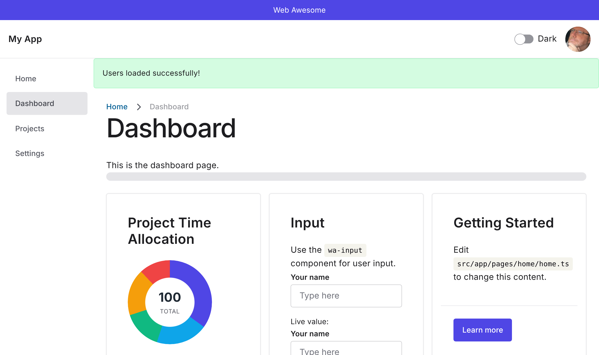

# angular-webawesome

An **Angular 21** port of the `react-webAwesome` app — a small dashboard built on
[WebAwesome](https://webawesome.com) web components. Same pages, components, mock
data and behaviour, re-expressed with idiomatic Angular.

**[Live demo](https://wedwu.github.io/angular-webawesome/)**



```bash
npm install
npm start          # ng serve  ->  http://localhost:4200
npm run build      # production build
```

## How it maps to the React original

| React (react-webAwesome)            | Angular (this repo)                                   |
| ----------------------------------- | ----------------------------------------------------- |
| `@lit/react` wrappers (`WaButton…`) | Native custom elements + `CUSTOM_ELEMENTS_SCHEMA`     |
| `src/WebAwesome/index.ts`           | `src/app/webawesome.ts` (side-effect element imports) |
| `ThemeContext` + `useTheme`         | `ThemeService` (root, signal + `effect`)              |
| `api/*.ts` promise mocks            | `api/*.service.ts` injectable promise mocks           |
| `react-router` `<Routes>`           | `provideRouter` + lazy `loadComponent` routes         |
| `useState` / `useEffect`            | `signal` / `computed` / `ngOnInit`                    |
| component props                     | `input()` / `output()`                                |
| JSX `&&` / `.map`                   | `@if` / `@for` control flow                            |
| `dangerouslySetInnerHTML`           | `[innerHTML]`                                          |

### Notes

- WebAwesome ships standard custom elements, so they're used directly as
  `wa-*` tags. Each component that uses them declares `CUSTOM_ELEMENTS_SCHEMA`.
- Because Angular renders a host element wrapper (React fragments don't), slotted
  components (`Header`, `NavBar`, `Footer`, `Aside`, `Breadcrumb`) set the `slot`
  on their host via `host: { slot: '…' }` and use `:host { display: contents }`.
- `setBasePath(...)` for WebAwesome assets is called in `main.ts`, mirroring the
  React `main.tsx`.
- The path alias `@/* -> src/app/*` mirrors the React `@/* -> src/*` alias.
- Minor fix: the React dashboard passed `variant: "outlined"` to a button, but
  `outlined` is a WebAwesome *appearance*, not a variant (it was a silent no-op
  in React). Here it's passed as `appearance: 'outlined'`.
